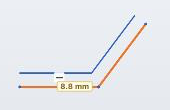
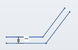

# Offset dimension

The dimension created by the [Offset](sketch-offset) tool: a single distance between the original chain of curves and its offset copy.

| Placing the offset | Finished offset with dimension 8 |
|---|---|
|  |  |

## How it is created {#create}

1. With the **Offset** tool (`O`), select a chain and click a side — see [Offset](sketch-offset).
2. A dimension field with the measured distance opens right away — enter the exact value and press `Enter`.

You cannot create an offset dimension separately with the **Dimension** tool.

## How it works {#how}

- One dimension drives all "original curve — copy" pairs in the chain: each copy stays parallel (concentric for arcs) to its original curve at the set distance.
- The offset side is kept: the copy does not jump to the other side.
- If you change the original chain (dimensions, dragging), the copy follows it.

## Editing and deleting {#edit}

- Double-click the dimension to enter a new value (an expression works too: `#wall`).
- Deleting the dimension (`Del`) keeps the copy but breaks the distance link.
- If you delete part of the copy, only that pair is removed from the dimension.

## See also {#see-also}

[Offset](sketch-offset), [Length and distance](dimension-distance).
