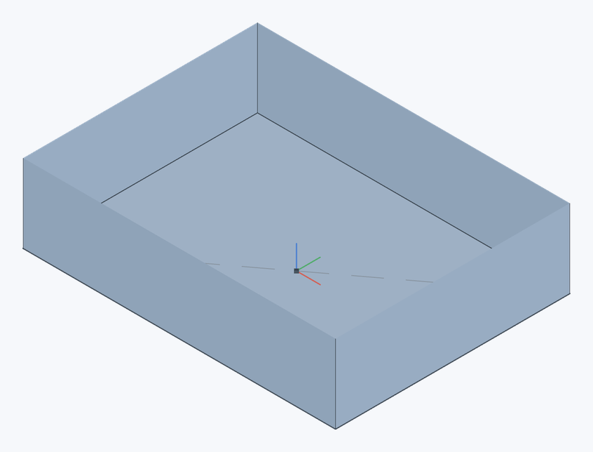
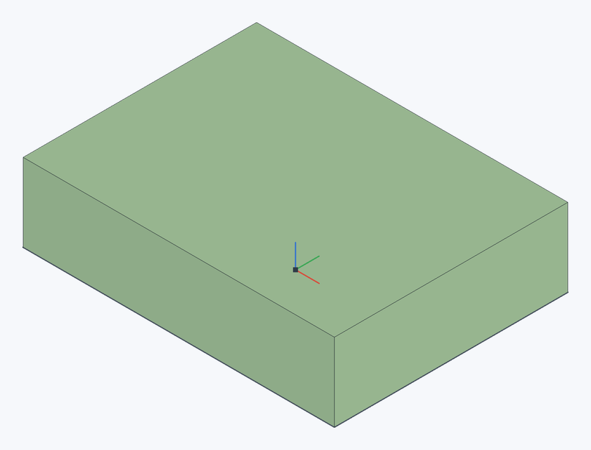

# Enclose

Turns [surfaces](offset-surface#surfaces) that close a volume between them into a solid part — like Onshape's Enclose. An open shell and its lid make a solid, surfaces built one by one make a part.

**Toolbar:** **Enclose**

## Steps {#steps}

1. Click **Enclose**.
2. In **Surfaces to enclose**, select the surfaces (in **Parts → Surfaces** or in the graphics area).
3. If needed, tick **Keep surfaces** — otherwise they are used up for the new solid.
4. Click ✓ (`Enter`).

The surfaces' edges must meet: together they make a closed shell with no gaps. A part whose [face was deleted](delete-face#no-heal) without healing and a [copy](offset-surface) of that face made beforehand, say, are sewn back into a whole solid.

## Example: close a block again {#example}

| Open surface | Enclosed with the lid |
|---|---|
|  |  |

1. On the original block use **Offset surface** on the top face with distance **0** to make a lid.
2. **Delete face** on the original top with **Heal** unchecked.
3. In **Enclose**, select both surfaces: the open shell and the lid. Click ✓.

Keep the lid in its original position so its edges meet the shell. The result is a solid 40 × 30 × 10 mm block again.

## Errors {#errors}

| Message | What happened |
|---|---|
| **The surfaces do not close a volume: their edges must meet** | There is a gap between the surfaces, or they cross without meeting edge to edge. |
| **Select surfaces (not solid parts) to enclose a volume** | A solid part is among the selected. |

> **Limitation.** Surfaces are not trimmed against each other: their edges must match.

## See also {#see-also}

[Offset surface](offset-surface), [Thicken](thicken), [Delete face](delete-face).
