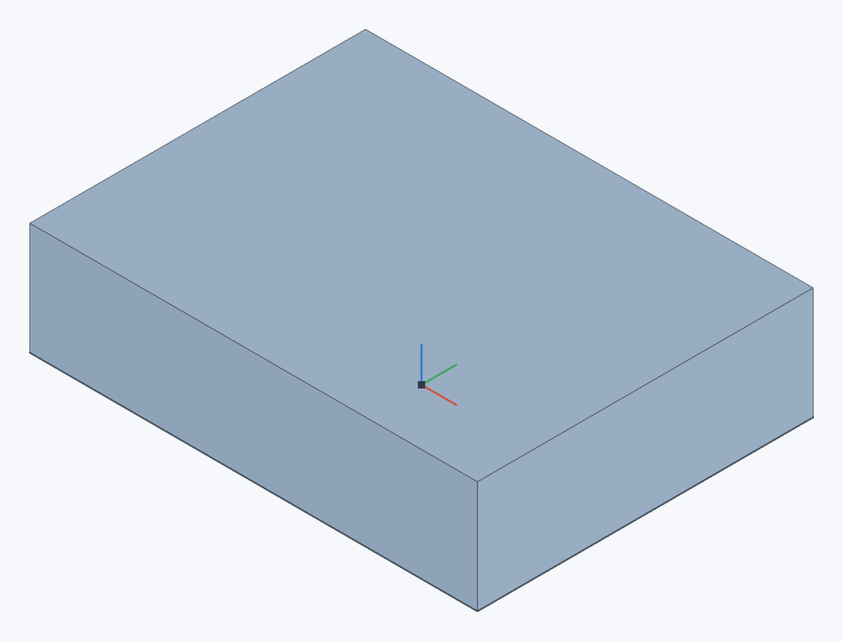
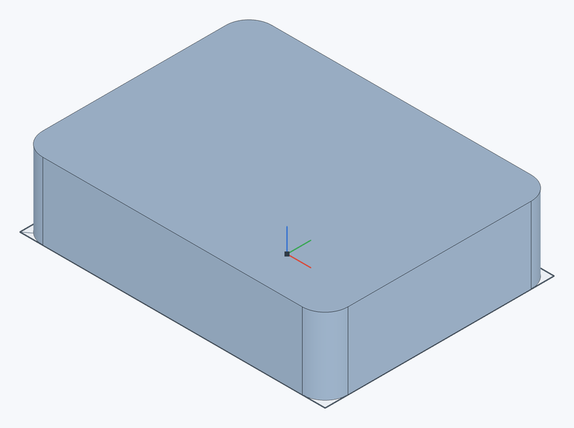

# Getting started

WebCAD is a parametric 2D/3D design system that runs in the browser and is modeled after Onshape. It works **offline** and **without sign-up**: documents are stored only in this browser (see [Offline use and storage](offline)).

A model is built as a **feature history**: sketches, extrudes, fillets, and other operations run in order from top to bottom. You can open and change any feature, and everything below it rebuilds automatically. You can enter dimensions as numbers, as expressions with units (`25 mm`, `1 in + 3 mm`), and with [variables](variables) (`#width / 2`).

## Your first part in five minutes {#first-part}

Build a **40 × 30 × 10 mm** plate with **R3** fillets on its vertical edges. Use mm as the document units.

### 1. A 40 × 30 mm sketch {#first-sketch}

1. On the **Documents** page, click **Create**. A new document opens with a **Part Studio** tab.
2. Click **Sketch** on the toolbar (`Shift+S`), then click the **Top** plane in the graphics area or in the feature list. The view turns normal to it, and the **Line** tool is active.
3. Select **Center rectangle** (`R`), click the origin, then click a corner point.
4. Select **Dimension** (`D`). Click the top edge, click where to place the dimension, type `40`, and press `Enter`. Set the side edge to `30` the same way.
5. Click **Finish sketch** (`Enter`).

### 2. A thickness of 10 mm {#first-extrude}

1. Click the shaded sketch region or its row in the feature list.
2. Click **Extrude** (`Shift+E`), leaving **New** and **Blind** selected.
3. Enter a **Depth** of `10` and click ✓ in the dialog header. One rectangular part should appear.

### 3. R3 fillets {#first-fillet}

1. Click **Fillet** (`Shift+F`).
2. Click the four vertical edges. Rotate the view by dragging with the right mouse button to reach the rear edges.
3. Enter a **Radius** of `3` and click ✓. Press `Shift+7` to restore the isometric view and `F` to fit the model in the window.

| Before filleting | After R3 fillets |
|---|---|
|  |  |

### 4. Save a file {#first-export}

1. Click **Export** in the top-right corner.
2. For another CAD system, choose **STEP** and **mm**. For 3D printing, choose **3MF** or **STL binary**; see [Import and export](import-export).
3. Check the parts listed in the dialog and click **Export**.

The document saves automatically in this browser. A geometry file does not contain the editable history: for a backup, choose the **WebCAD project** format (`.webcad.json`) in **Export**, or work in a [folder on your computer](documents#folder).

| If something goes wrong | What to check |
|---|---|
| The sketch region cannot be selected | Finish the sketch and check that its profile is closed. |
| Filleting reports an error | Select only the four vertical edges and a radius of `3`, rather than every edge of the part. |
| The model does not fit in the window | Press `F`. |

> **Tip.** To change the plate size, double-click the sketch in the [feature list](feature-list), double-click a dimension, enter a new value, and finish the sketch. The extrude and fillets rebuild automatically.

## What's next {#next}

- [User interface](interface): the parts of the editor window.
- [View controls](view-controls): mouse, view cube, standard views.
- [Sketch overview](sketch): drawing tools, snapping, constraints, and dimensions.
- [Extrude](extrude) and other Part Studio features.
- [Variables and expressions](variables): parametric models.
- [Keyboard shortcuts](keyboard-shortcuts): all shortcuts on one page.

## Using this help {#help}

- `F1` in the editor opens help for the current sketch tool or the open feature dialog; otherwise it opens this page.
- The **?** button in a feature dialog header opens the page for that feature; the **?** button in the top bar opens help for the current context.
- Help opens in a new browser tab, works offline, and is available in Russian and English (the **RU / EN** switch at the top of the page).
- The **WebCAD** logo in the help's header opens the documents list; the word **Help** next to it opens the first help page.
- Search looks through the headings and text of all pages. Press `/` to move the cursor to the search field.
- Click an illustration to open it at full size in a new tab. Diagram numbers are explained in the captions.
