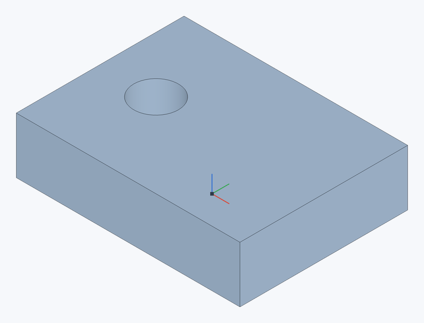
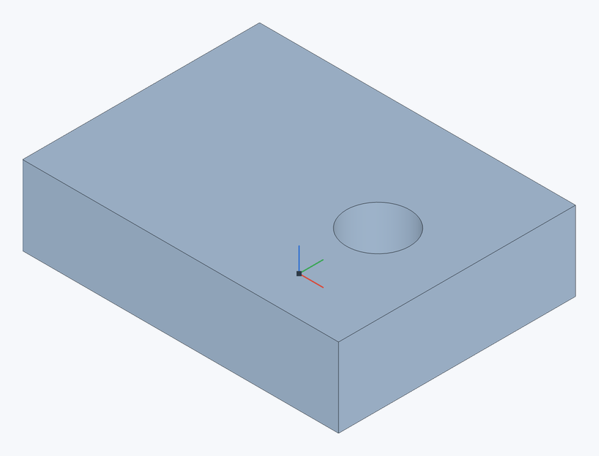

# Move face

A direct edit, like Onshape's Move face: faces of a part are offset, translated or rotated, and the faces around them extend or shrink to follow. Handy for imported parts with no history and for quick changes — raise a top, shift a hole, tilt a face.

**Toolbar:** **Move face**

## Steps {#steps}

1. Select faces and click **Move face** (or click the button and select the faces).
2. Choose how: **Offset**, **Translate** or **Rotate**.
3. For a translation choose the **Direction**, for a rotation the **Axis**.
4. Set the **Distance** or **Angle** (the button next to it flips the direction), click ✓ (`Enter`).

## Example: move a hole {#example}

| Before | Translate 20 mm along X |
|---|---|
|  |  |

1. Select the cylindrical wall of the through hole.
2. In **Move face**, choose **Translate**.
3. For **Direction**, select a straight plate edge along X and set **Distance** to 20 mm. Flip the direction if needed.
4. Accept: the diameter and depth stay the same and the former position is healed.

## Types {#types}

| Type | What happens |
|---|---|
| **Offset** | Each planar face moves along its own normal: a positive distance out of the material, a negative one into it. That is how a block's top goes up or a wall gets thicker. |
| **Translate** | The faces move along a direction (an edge, a sketch line, a planar face's normal or a plane). |
| **Rotate** | The faces turn about an axis (a straight or circular edge, a sketch line, a cylindrical face, a mate connector). |

What moves depends on the selection:

- **All the faces of a hole, pocket or boss** move as one: the hole or boss goes to its new place, the old one is healed. A through hole's cylindrical face translated by 12 mm is the same hole 12 mm further on.
- **Separate planar faces** each go to their new plane, and the faces around them, planar too, extend or shrink to it. Translating a planar face along itself changes nothing — only the part along the normal counts, as in Onshape.

## Limitations {#limits}

- **Offset** works for planar faces and for the cylindrical walls of holes and bosses: a cylinder changes its radius (an offset out of the material narrows a hole and thickens a boss). Its ends must lie on faces square to its axis. Move holes and bosses with **Translate** or **Rotate**, all their faces selected.
- A separate face moving along its normal may border on walls along that normal — planar or cylindrical (a rounded vertical corner, a hole in the face): they extend with it. To tilt a face or put it on a slanted plane, all the faces around it must be planar.
- Only full cylinders change their radius; change partial ones (fillets) with [Fillet](fillet).

## See also {#see-also}

[Replace face](replace-face), [Delete face](delete-face), [Transform](transform) — moving whole parts.
