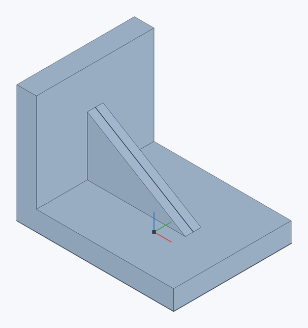

# Rib

Builds ribs from sketch curves, like Onshape's Rib: each curve becomes a wall of a thickness that runs from the curve to the parts and merges with them. A gusset in the inner corner of a bracket, or ribs under a plate, are the usual cases.

**Toolbar:** **Rib**

## Steps {#steps}

1. Draw a [sketch](sketch) with lines or arcs where the ribs go. For a gusset in a bracket's corner, sketch on the middle plane, a line across the corner from the wall to the flange.
2. Click **Rib** and select the sketch curves.
3. Set the **Thickness** and the **Rib direction**, click ✓ (`Enter`).

A 40 × 30 mm base, 5 mm thick, with a 30 mm high wall. A line on **Front** runs from the wall to the base. A **4 mm** rib **parallel to the sketch plane** fills the corner and merges with the bracket.

## Options {#options}

| Field | Description |
|---|---|
| **Sketch curves** | Lines and arcs; each makes a rib of its own. |
| **Thickness** | The wall's thickness (default 3 mm). |
| **Rib direction** | **Parallel to sketch plane** — the rib grows within the sketch plane, from the curve across it, its thickness split evenly about the plane (a gusset). **Normal to sketch plane** — the rib grows along the sketch's normal, its thickness split evenly about the curve (ribs dropped onto a plate). |
| **Opposite direction** | The rib grows the other way. By default the side where it meets a part is taken. |
| **Extend profiles up to part** | Lines run on from both ends up to the parts they point at (on by default): a gusset's line need not reach the wall and the flange exactly. |
| **Merge with all** / **Merge scope** | The parts the rib meets and merges with. |

The rib ends where it meets a part. With no part that way, the feature says "The rib does not meet a part".

> **Limitation.** Along the sketch normal a rib takes lines and arcs only. Only lines are extended (arcs are not). Ribs have no draft yet.

## See also {#see-also}

[Extrude](extrude) with a wall (**Thin**), [Shell](shell).
