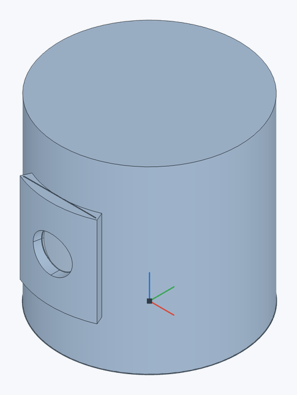

# Wrap

Rolls sketch regions onto a cylindrical face without stretching, like Onshape's Wrap: a label, a logo or a knurl goes onto a shaft and stands out of it (**Emboss**) or sinks into it (**Deboss**).

**Toolbar:** **Wrap**

## Steps {#steps}

1. Make a [plane](plane) touching the cylinder (the **Front** plane moved out by the radius, say) and draw a [sketch](sketch) on it — a rectangle, a circle, an outline.
2. Click **Wrap** and choose **Emboss** or **Deboss**.
3. In **Sketch regions to wrap**, select the sketch's regions.
4. In **Cylindrical face to wrap onto**, select the shaft's or hole's face.
5. Set the **Depth**, click ✓ (`Enter`).

A Ø40 mm cylinder, 40 mm high, and **Front** offset 20 mm towards its front surface. The sketch contains a 16 × 20 mm rectangle with a Ø8 mm circle inside. Select the region **between the rectangle and circle**, choose **Emboss**, depth **2 mm**. The inner circle stays at the original cylinder surface.

## How a region lies {#mapping}

The sketch plane must run along the cylinder's axis (parallel to it). The region rolls on from the line where the cylinder is nearest to the plane: the distance across the axis becomes an arc as long on the surface, the distance along the axis stays as it is. So the region keeps its sizes on the surface: a 10 × 20 mm rectangle on a shaft of radius 20 mm goes 10 mm round it (half a radian) and stands 20 mm tall. Holes in regions (a ring round a circle, say) are kept.

**Emboss** raises the region out of the material by **Depth**, **Deboss** sinks it in. On an inner face (a hole) "out of the material" is towards the axis.

## Limitations {#limits}

- The region must fit on the face: no longer than the cylinder is round. On a full cylindrical face (a shaft, a hole) it may run across the seam too — the line where the face's circle starts and ends; on part of a cylinder it must not run past the face's edges.
- Cylindrical faces only. Cones and freeform surfaces are not supported.

## See also {#see-also}

[Plane](plane), [Thicken](thicken), [Extrude](extrude).
