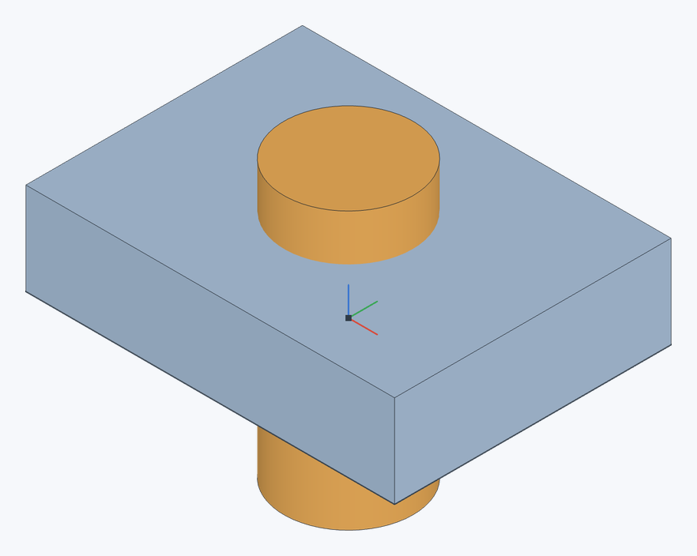
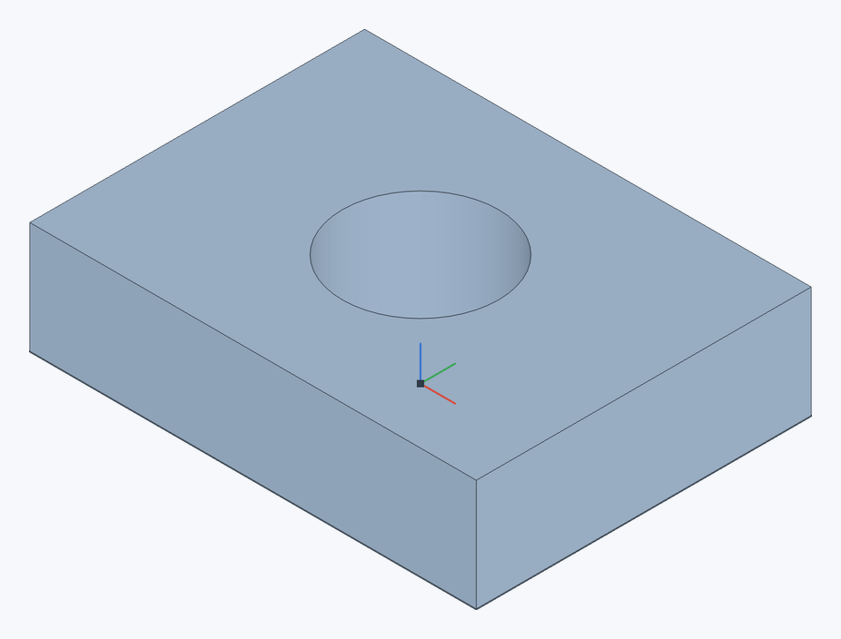

# Булева операция

Объединяет, вычитает или пересекает существующие детали.

**Панель инструментов:** **Булева операция**

| До вычитания | После вычитания |
|---|---|
|  |  |

В примере **Цель** — пластина, **Инструмент** — цилиндр диаметром 14 мм. Флажок **Сохранить инструменты** выключен.

## Порядок действий {#steps}

1. Нажмите **Булева операция** и выберите тип: **Объединение**, **Вычитание** или **Пересечение**.
2. В поле **Инструменты** выберите детали.
3. Для **Вычитание** щёлкните поле **Цели** и выберите детали, из которых вычитать. Для **Пересечение** с флажком **Сохранить инструменты** в поле **Цели** выберите детали, которые обрезать по инструментам.
4. Нажмите ✓ (`Enter`).

## Параметры {#options}

| Тип | Результат |
|---|---|
| **Объединение** | Все **Инструменты** (не меньше двух) сливаются в одну деталь — первую из выбранных. |
| **Вычитание** | Из каждой детали в **Цели** вычитаются **Инструменты**. Инструменты удаляются, если не включён флажок **Сохранить инструменты**. |
| **Пересечение** | От **Инструментов** (не меньше двух) остаётся их общий объём — в первой детали; если общего объёма нет, появится сообщение «Детали не пересекаются». С флажком **Сохранить инструменты** появляется поле **Цели**: каждая деталь из него сохраняет только то, что лежит внутри всех инструментов, а инструменты остаются как были. |

## Поверхности {#surfaces}

- **Объединение** [поверхностей](offset-surface#surfaces) сшивает их в одну по рёбрам, где они сходятся (края должны совпадать — например, после [обрезки друг о друга](split#trim)). Поверхности объединяются только с поверхностями, детали — с деталями.
- **Вычитание** детали из поверхности: в **Цели** — поверхность, в **Инструменты** — деталь. От поверхности остаётся то, что лежит вне детали: например, цилиндр прорезает в листе круглое отверстие.
- Поверхность не бывает инструментом вычитания или пересечения: поверхность о поверхность обрезается [Разделением](split#trim).

> **Совет.** Если тело создаётся фичей, проще сразу выбрать в ней операцию **Добавить**, **Вычесть** или **Пересечь** — см. [Диалоги фич](feature-dialogs#operation).
