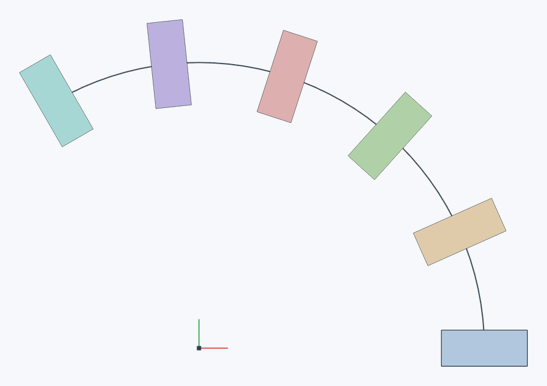

# Массив по кривой

Копирует детали или фичи вдоль кривой — линии, дуги или цепочки рёбер и кривых эскиза, как Curve pattern в Onshape. Копии поворачиваются вслед за кривой: например, бобышки на дуге смотрят каждая к центру, как и исходная.

**Панель инструментов:** **Массив по кривой**

## Порядок действий {#steps}

1. Нажмите **Массив по кривой**.
2. Выберите **Массив деталей** или **Массив фич** и укажите, что копировать.
3. Щёлкните поле **Путь** и выберите кривые эскиза или рёбра — они должны идти одной цепочкой.
4. Задайте **Количество** (вместе с исходным), нажмите ✓ (`Enter`).

Первый экземпляр — исходный: путь отсчитывается от его начала, так что удобно, чтобы исходная деталь или фича стояла у начала пути. Каждая копия переносится туда, куда дошла бы начальная точка пути, и поворачивается так, как повернулась кривая.

Пример: деталь 12 × 5 × 8 мм стоит в начале дуги радиусом 40 мм с углом 120°. **Количество — 6**, включены **Равномерно** и **Поворачивать по кривой**. Соседние детали поворачиваются на 24°; первая и последняя стоят на концах дуги. Без **Поворачивать по кривой** прямоугольники сохранят направление исходного.

## Параметры {#options}

| Поле | Описание |
|---|---|
| **Массив деталей** / **Массив фич** | Что копировать, см. [Линейный массив](linear-pattern#feature-pattern). |
| **Путь** | Кривые эскиза, рёбра, спираль — одной цепочкой. |
| **Количество** | Число экземпляров вместе с исходным (по умолчанию 4). |
| **Равномерно** | Экземпляры распределяются по всему пути: у открытого — от начала до конца, у замкнутого — по кругу. Без флажка задайте **Расстояние** между соседними экземплярами вдоль пути. |
| **С другого конца** | Отсчитывать путь от другого конца. |
| **Поворачивать по кривой** | Копии поворачиваются вместе с кривой (по умолчанию). Без флажка они только переносятся и сохраняют ориентацию исходного. |
| **Новая** / **Добавить** | Для массива деталей: отдельные детали или объединение с исходной. |

У плоской кривой копии поворачиваются в её плоскости; у пространственной (например, [спирали](helix)) — без лишнего закручивания вокруг кривой.

## См. также {#see-also}

[Линейный массив](linear-pattern), [Круговой массив](circular-pattern), [Протягивание](sweep).
