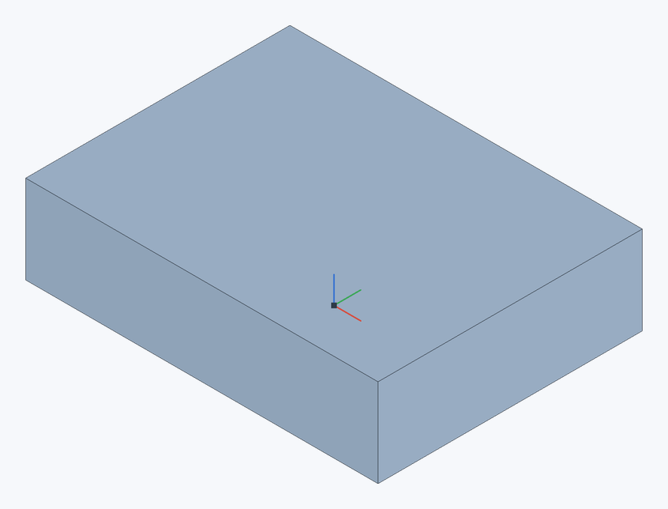

# Удалить грань

Прямое редактирование, как Delete face с залечиванием (Heal) в Onshape: выбранные грани удаляются, а разрыв закрывается соседними гранями. Так убирают ненужные элементы из импортированных деталей или упрощают деталь: заполняют отверстия, убирают скругления и фаски, срезают бобышки.

**Панель инструментов:** **Удалить грань**

## Порядок действий {#steps}

1. Выберите грани и нажмите **Удалить грань** (или нажмите кнопку и выберите грани).
2. Нажмите ✓ (`Enter`).

| До: сквозное отверстие Ø8 мм | После удаления с залечиванием |
|---|---|
|  |  |

Выберите **внутреннюю стенку отверстия**, а не верхнюю грань пластины. Наружные размеры 40 × 30 × 10 мм сохраняются.

## Что можно удалить {#what}

| Выбор | Результат |
|---|---|
| Все грани **отверстия** или **кармана** (для сквозного отверстия — его цилиндр, для глухого — цилиндр и коническое дно) | Отверстие заполняется материалом. |
| Все грани **бобышки** (боковые и верх) | Бобышка срезается до грани, на которой стоит. |
| **Скругление** или **фаска** между плоскими гранями | Соседние плоские грани продлеваются до острого ребра — и для выпуклого ребра (материал возвращается), и для вогнутого (материал убирается). |

Граница выбранных граней должна замыкаться на соседних гранях (как у отверстия на верхней грани) или все соседние грани должны быть плоскими (как у скругления). Если поверхность разбита на несколько граней (например, скругление после [смещения](move-face) верхней грани), достаточно выбрать одну — остальные куски той же поверхности удаляются вместе с ней.

## Ошибки {#errors}

| Сообщение | Что случилось |
|---|---|
| **Соседние грани не могут закрыть разрыв** | Выбрана часть элемента (например, одна стенка кармана) или соседи не плоские. Выберите отверстие, карман или бобышку целиком. |
| **Эти грани нельзя залечить** | Например, выбрана одна плоская грань блока: продлевать нечего. Чтобы передвинуть такую грань, используйте [Переместить грань](move-face). |

## Без залечивания {#no-heal}

Снимите флажок **Залечить** — выбранные грани просто удаляются, а деталь превращается в [поверхность](offset-surface#surfaces) из оставшихся граней (как Delete face без Heal в Onshape). Так можно, например, вскрыть деталь, чтобы взять её грани за основу, а потом [утолщить](thicken) оболочку.

Верх удалён без залечивания. Это открытая поверхность **без толщины стенок**; для полой твёрдой детали со стенками используйте [Оболочку](shell).

## См. также {#see-also}

[Переместить грань](move-face), [Заменить грань](replace-face), [Скругление](fillet).
