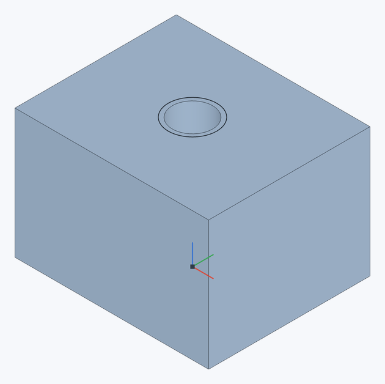
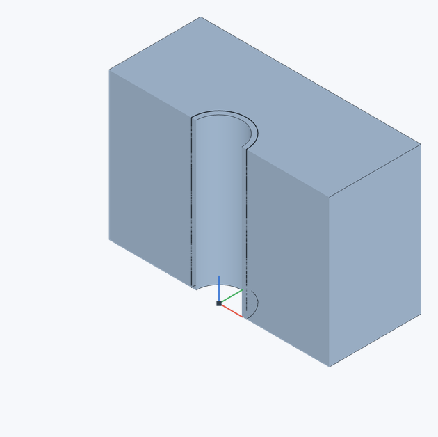
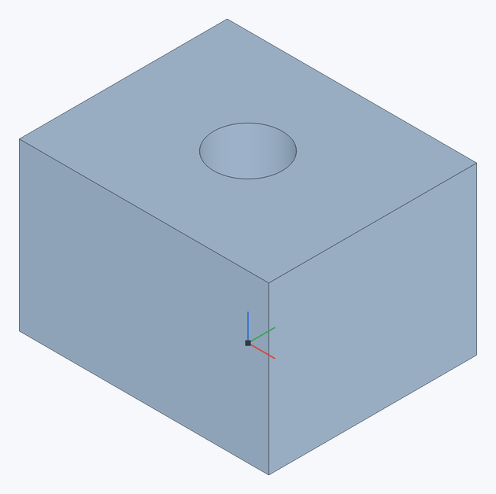
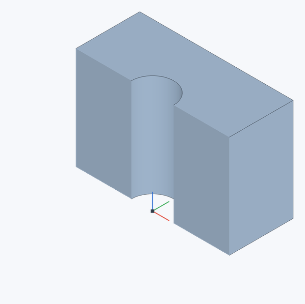
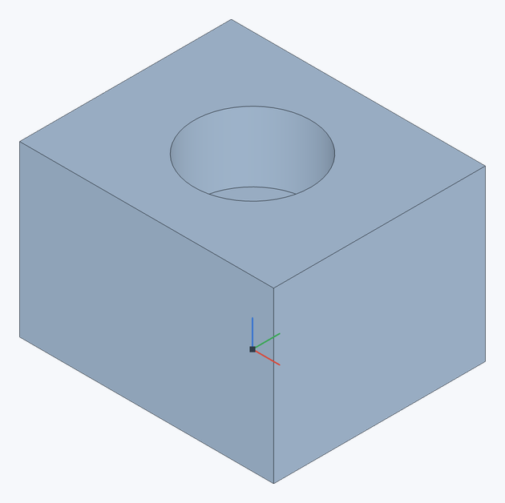
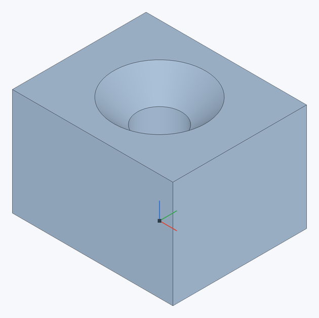
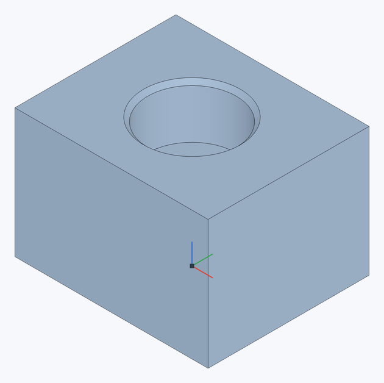
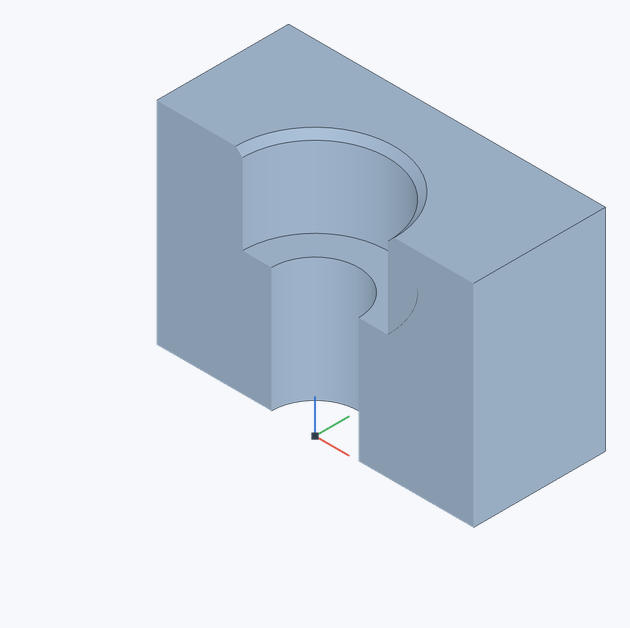

# Отверстие

Создаёт сверлёные отверстия — простые, с цековкой или с зенковкой — в точках эскиза.

**Панель инструментов:** **Отверстие**

## Порядок действий {#steps}

1. Нарисуйте эскиз на грани детали и поставьте [точки](sketch-point) в центрах будущих отверстий.
2. Нажмите **Отверстие**.
3. Выберите **Вид отверстия**: **Простое**, **С цековкой**, **С зенковкой** или **С цековкой и зенковкой**.
4. Выберите точки эскиза (или круговые рёбра — тогда отверстие ставится в их центр).
5. Выберите **Окончание** и задайте **Диаметр** и остальные размеры — или выберите **Стандарт: ISO** и размер крепежа, см. [ниже](#standard). Нажмите ✓ (`Enter`).

Отверстие начинается в плоскости эскиза и идёт в материал — против нормали плоскости эскиза (для кругового ребра — вдоль его оси).

```figure
image: ../images/hole-result.png
alt: Два сквозных отверстия с цековками в пластине
caption: Две точки эскиза задают центры отверстий: диаметр 6 мм, цековка диаметром 10 мм и глубиной 3 мм.
width: 480
```


## Параметры {#options}

| Поле | Описание |
|---|---|
| **Вид отверстия** | **Простое**, **С цековкой**, **С зенковкой** или **С цековкой и зенковкой** (как Counterdrill в Onshape): цековка, у входа в которую снята зенковка — например, чтобы головка винта не цепляла острую кромку. |
| **Точки эскиза для отверстий** | Точки эскизов или круговые рёбра. |
| **Окончание** | **На глубину** или **Насквозь**. |
| **Диаметр** | Диаметр отверстия (по умолчанию 5 мм). |
| **Глубина** | Для **На глубину** (по умолчанию 10 мм). |
| **Угол при вершине** | Конус на дне глухого отверстия (по умолчанию 118°, как у сверла). |
| **Диаметр цековки**, **Глубина цековки** | Для **С цековкой** и **С цековкой и зенковкой** (по умолчанию 9 и 4 мм). Диаметр цековки должен быть больше диаметра отверстия. |
| **Диаметр зенковки**, **Угол зенковки** | Для **С зенковкой** и **С цековкой и зенковкой** (по умолчанию 10 мм и 90°). У цековки с зенковкой диаметр зенковки больше диаметра цековки, а сама зенковка кончается выше дна цековки. |
| **Глубина углубления** | Для **С зенковкой**: цилиндрическое углубление диаметром зенковки над её конусом — зенковка утоплена на эту глубину (по умолчанию 0 — без углубления). Так делают гнездо под потайную головку, утопленную ниже поверхности. |
| **Стандарт** | **Свой** — размеры из полей выше; **ISO** — из таблиц стандартов, см. [ниже](#standard). |
| **Глубина резьбы** | Для резьбового отверстия **На глубину**: на какую глубину нарезана резьба (не глубже отверстия). |
| **Объединить со всеми** / **Область объединения** | Из каких деталей вырезать отверстия: из всех или только из выбранных. |

## Стандартные отверстия ISO {#standard}

С **Стандартом: ISO** размеры берутся из таблиц для метрического крепежа M1.6–M64, поля диаметров скрываются, а под выбором показаны получившиеся размеры.

- **Тип: Под крепёж** — отверстие под винт по ISO 273. **Посадка**: **Точная**, **Средняя** или **Грубая** (fine / medium / coarse), например для M6 — 6,4 / 6,6 / 7 мм.
- **Тип: Резьбовое** — отверстие под метчик (сверло по ISO 2306, для M6 — 5 мм) с [косметической резьбой](#thread). **Шаг**: крупный (по умолчанию) или один из мелких по ISO 261; для мелкого шага сверло — номинал минус шаг, обозначение — M8×1.
- **С цековкой** — цековка под винт с цилиндрической головкой ISO 4762 (по DIN 974-1), **С зенковкой** — зенковка 90° под потайной винт ISO 10642, **С цековкой и зенковкой** — та же цековка с фаской 0,5 мм × 45° у входа.
- При выборе размера глубины задаются как у Onshape: глубина резьбы — 2 диаметра, отверстие — на 3 шага глубже. Их можно изменить.

```figure
image: ../images/iso-hole-dialog.jpg
alt: Диалог отверстия: ISO, резьбовое M6, шаг 1 мм, насквозь
caption: Пример: выберите ISO → Резьбовое → M6 → шаг 1 мм. Диаметр сверла 5 мм подставится автоматически (подсказка под полями). На снимке окончание — Насквозь, поэтому отдельного поля глубины резьбы нет.
width: 350
```

## Как выглядит резьбовое ISO-отверстие {#appearance}

На снимках — блок 24 × 20 × 16 мм, **ISO → Резьбовое → M6**, шаг 1 мм, **Насквозь**.

| Обычный вид | Сечение через ось отверстия |
|---|---|
|  |  |

Отверстие построено под сверло **Ø5 мм**. Тонкая окружность Ø6 мм у входа и тонкие линии в сечении обозначают резьбу **условно**: винтовых витков в геометрии нет. Чтобы посмотреть такой разрез своей модели, включите [Сечение](section-view) и проведите плоскость через ось отверстия.

## Варианты входа и сечения {#cuts}

Те же блок и размер крепежа **M6**, но **Тип → Под крепёж**, **Посадка → Средняя**, **Насквозь**. Основное отверстие во всех строках — **Ø6,6 мм**; меняется **Вид отверстия**. Слева виден вход, справа — профиль выреза в сечении.

| Вид отверстия | В модели | В сечении |
|---|---|---|
| **Простое** — без углубления под головку |  |  |
| **С цековкой** — цилиндрическое углубление Ø11 мм глубиной 6,6 мм |  |  |
| **С зенковкой** — коническое углубление под потайную головку, 90° |  |  |
| **С цековкой и зенковкой** — цековка с фаской 0,5 мм × 45° у входа |  |  |

Выберите нужный **Вид отверстия** вверху диалога. В режиме **ISO** размеры берутся из выбранного стандарта и размера крепежа; для своих диаметров и глубин переключите **Стандарт → Свой**.

## Косметическая резьба {#thread}

Резьба резьбового отверстия не моделируется (отверстие — диаметра сверла), а показывается условно, как в Onshape:

- в графической области — тонкая окружность наружного диаметра резьбы у начала резьбы, а в [сечении](section-view) — линии вдоль неё;
- на [чертежах](drawings) по ISO 6410: на виде со стороны входа — тонкая дуга в ¾ окружности наружного диаметра, на видах сбоку — невидимые тонкие линии вдоль резьбы и поперёк её конца (если включены невидимые линии).

Резьба начинается под цековкой или зенковкой. У глухого отверстия она идёт на **Глубину резьбы**, у сквозного — до выхода из материала. Резьба следует за деталью при [перемещении](transform), копируется массивами и [зеркалом](mirror) отверстия или детали и приходит вместе с деталью в [производную геометрию](derived).

> **Ограничение.** Только метрический стандарт ISO (ANSI/дюймового нет). Обозначения резьбы на чертеже (выноски M8 ↧16) пока не ставятся.

## См. также {#see-also}

[Точка](sketch-point), [Выдавливание](extrude) с операцией **Вычесть**, [Линейный массив](linear-pattern).
