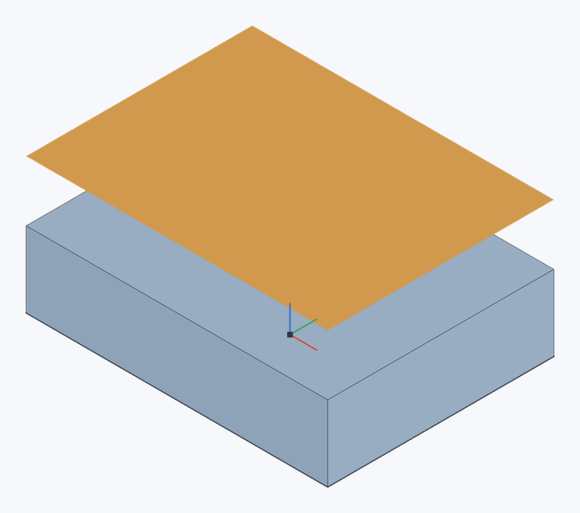

# Смещение поверхности

Создаёт поверхность — тело из граней без толщины и объёма — на заданном расстоянии от выбранных граней, как Offset surface в Onshape. При расстоянии 0 получается копия граней. Поверхности служат опорной геометрией (например, для [замены грани](replace-face) или эскиза на них) и превращаются в твёрдое тело [Утолщением](thicken).

**Панель инструментов:** **Смещение поверхности**

## Порядок действий {#steps}

1. Выберите грани и нажмите **Смещение поверхности** (или нажмите кнопку и выберите грани).
2. Задайте **Расстояние**: положительное — наружу из материала, вдоль нормалей граней. Кнопка рядом меняет сторону.
3. Нажмите ✓ (`Enter`).

Грани одной детали сшиваются в одну поверхность, у граней разных деталей — свои поверхности.

Пример: выбрана верхняя грань блока высотой 10 мм, **Расстояние** — 8 мм. Оранжевая поверхность лежит на высоте 18 мм; исходный блок остаётся на месте. При расстоянии 0 копия совпадёт с исходной гранью.

## Поверхности в модели {#surfaces}

- В списке **Детали** поверхности собраны в отдельную группу **Поверхности** и называются «Surface 1», «Surface 2»…; номера деталей их не учитывают.
- Поверхность видна с обеих сторон, её грани и рёбра выбираются как у деталей, её можно скрыть, переименовать, переместить, экспортировать (STEP, STL).
- Выдавливание или отверстие с **Объединить со всеми** поверхности не задевают. [Булева операция](boolean#surfaces) сшивает поверхности между собой и вычитает из них детали, [Разделение](split) режет их плоскостью, гранью или другой поверхностью — так поверхности [обрезаются друг о друга](split#trim).
- [Измерение](measure) поверхности показывает её площадь (объёма и массы у неё нет).
- Поверхности строятся также [выдавливанием](extrude#surface), [вращением](revolve#surface) и [сдвигом по траектории](sweep#surface) кривых эскиза; поверхностью становится и деталь, у которой [удалены грани](delete-face) без залечивания.

## Утолщение поверхности {#thicken}

[Утолщение](thicken) принимает поверхность целиком: каждая её грань утолщается вдоль нормали, а острые углы между плоскими гранями заполняются (с острой внешней кромкой), так что получается одно сплошное тело.

Поверхности создаются смещением граней, удалением граней без залечивания и [выдавливанием](extrude#surface) кривых эскиза в режиме **Поверхность**; замыкающие объём поверхности [сшиваются в тело](enclose).

> **Ограничение.** Поверхности не обрезаются друг о друга, вращение и протягивание в поверхность пока не поддерживаются.

## См. также {#see-also}

[Утолщение](thicken), [Удалить грань](delete-face), [Заменить грань](replace-face).
