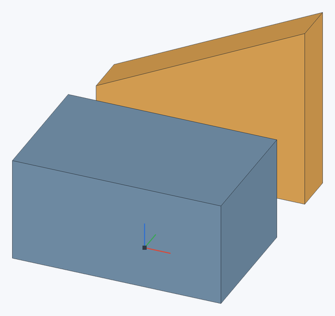
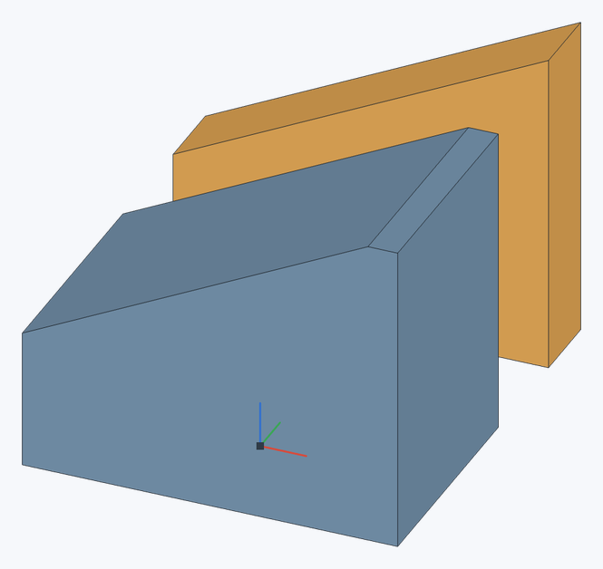

# Заменить грань

Прямое редактирование, как Replace face в Onshape: плоские грани детали переходят на заданную плоскость (со смещением от неё), а соседние грани удлиняются или укорачиваются до неё. Так можно выровнять верх детали по другой детали или по плоскости, сделать стенку заданной толщины или срезать деталь наклонно.

**Панель инструментов:** **Заменить грань**

## Порядок действий {#steps}

1. Нажмите **Заменить грань**.
2. В поле **Грани для замены** выберите плоские грани.
3. В поле **Заменить на** выберите плоскость, плоскую грань (в том числе другой детали) или [соединитель](mate-connector) — его плоскость XY.
4. При необходимости задайте **Смещение** от этой плоскости (кнопка рядом меняет сторону), нажмите ✓ (`Enter`).

Сторона, в которую отсчитывается смещение, — та, куда смотрит заменяемая грань (наружу из материала).

## Пример: выровнять верх по наклонной грани {#example}

**Синим** показан изменяемый блок 40 × 25 × 20 мм, **оранжевым** — отдельная опорная деталь с наклонным верхом. Требуется продолжить плоскость оранжевой грани на синий блок.

| До: горизонтальный верх блока | После: верх совпадает с плоскостью опорной грани |
|---|---|
|  |  |

1. Откройте **Заменить грань**.
2. В **Грани для замены** выберите **верхнюю грань синего блока**.
3. Переключитесь в **Заменить на** и выберите **наклонную верхнюю грань оранжевой детали**.
4. Оставьте **Смещение = 0** и нажмите ✓.

Верх синего блока становится наклонным: высота на одном краю — 15 мм, на другом — 35 мм. Боковые стенки удлиняются или укорачиваются до новой плоскости. Оранжевая деталь не меняется; детали остаются раздельными. Для такой операции они могут находиться на расстоянии друг от друга.

> **Совет.** Если опорную грань закрывает синий блок, поверните модель или выберите её с другого ракурса. Выбирайте именно наклонную грань сверху, а не вертикальную стенку опорной детали.

## Ограничения {#limits}

- Заменяются только плоские грани и только на плоскость; соседние грани должны быть плоскими (см. [Переместить грань](move-face#limits)).

## См. также {#see-also}

[Переместить грань](move-face), [Удалить грань](delete-face).
